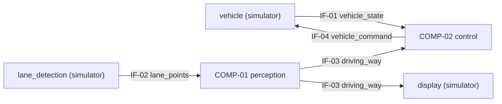

# 03. Software Architecture (SWE.2)

## Operating Environment
Ubuntu 22.04, ROS 2 Humble, communication over ROS 2 topics (DDS publish-subscribe).
No extra libraries.

## Components (static aspects)
A component is a ROS 2 node. Two-digit IDs (`COMP-01`). Every SWR is allocated to at least one component.
Input / Output: IDs of the interfaces (`IF-01`) the component subscribes to / publishes.

<!-- Example: both components are nodes the team adds to the package autonomous_driving (Lecture 07: perception node and
     control node). The provided node autonomous_driving is kept for manual driving only (launch argument manual:=true)
     and is not a component of the lane keeping function. -->

| ID | Name | Role | Units (functions) | Input | Output | Allocated SWR |
|---|---|---|---|---|---|---|
| COMP-01 | perception | Estimates the lane center ahead (driving way) | FindDrivingWay | IF-02 | IF-03, IF-05 | SWR-001, SWR-003 |
| COMP-02 | control | Follows the driving way at the target speed and sends the vehicle command | LateralControl, LongitudinalControl | IF-01, IF-03 | IF-04, IF-06 | SWR-001, SWR-002, SWR-003, SWR-004 |

## Interfaces
An interface is a ROS 2 topic. Two-digit IDs (`IF-01`).
Producer / Consumer: ID of the component (`COMP-01`) that publishes / subscribes to the topic.

<!-- Example: topics of the simulator are listed with the simulator node as producer or consumer.
     Topics the team does not use (mission, poly_lanes, /manual_input) are not listed.
     IF-05 and IF-06 use a message the team added to ad_msgs (msg/ComputationTime.msg): std_msgs has no type for a value with its period. -->

| ID | Name (topic) | Producer | Consumer | Message Type | Content and Unit | Rate |
|---|---|---|---|---|---|---|
| IF-01 | `vehicle_state` | vehicle (simulator) | COMP-02 | `ad_msgs/VehicleState` | x, y [m] (frame `world`), yaw [rad], yaw_rate [rad/s], velocity [m/s] | 100 Hz |
| IF-02 | `lane_points` | lane_detection (simulator) | COMP-01 | `ad_msgs/LanePointData` | detected points of the lane markings in one list, x, y [m] (frame `ego/body`), not sorted by lane | 30 Hz |
| IF-03 | `driving_way` | COMP-01 | COMP-02, display (simulator) | `ad_msgs/PolyfitLaneData` | lane center line y = a0 + a1 x + a2 x² + a3 x³, x and y [m] (frame `ego/body`) | 100 Hz |
| IF-04 | `vehicle_command` | COMP-02 | vehicle (simulator) | `ad_msgs/VehicleCommand` | steering [rad], accel [0 to 1], brake [0 to 1] | 100 Hz |
| IF-05 | `computation_time/perception` | COMP-01 | none (recorded for SWR-003) | `ad_msgs/ComputationTime` (added by the team) | period [ms], computation time of the period [ms] | 100 Hz |
| IF-06 | `computation_time/control` | COMP-02 | none (recorded for SWR-003) | `ad_msgs/ComputationTime` (added by the team) | period [ms], computation time of the period [ms] | 100 Hz |

## Dynamic Aspects
Both components run on a 10 ms timer (`loop_rate_hz` 100) and publish the computation time of every period.
Only COMP-02 publishes `vehicle_command`.

| Component | Trigger | Period [ms] | Behavior while an input is missing |
|---|---|---|---|
| COMP-01 | timer | 10 | publishes nothing until IF-02 arrives |
| COMP-02 | timer | 10 | publishes nothing until IF-01 and IF-03 arrive |

Mode: `ros2 launch autonomous_driving autonomous_driving.launch.xml` (as in `launch.sh`) starts COMP-01 and COMP-02.
With `manual:=true` it starts the provided node `autonomous_driving` instead, which passes `/manual_input` through.

## Diagram

## Analysis Results
- Two components, as in Lecture 07: perception follows the lane input (30 Hz) and can be tested alone with fake lane points;
  control is the only publisher of `vehicle_command`.
- Timing: both nodes run every 10 ms and publish the period with the computation time of each period (IF-05, IF-06),
  so SWR-003 can be checked in any run from a rosbag.
- The provided node `autonomous_driving` stays unchanged for manual driving; it is never started together with COMP-02.

## Review
| Gate | Pull Request | Reviewed by | Merged on |
|---|---|---|---|
